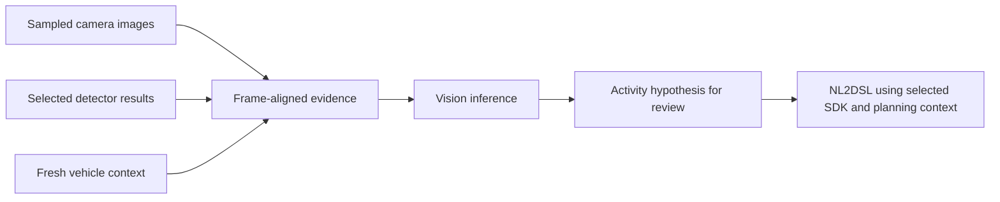

# Detector evidence for Inferred Mission

Reviewed November 16, 2026.

SteelEagle can already produce object class names, confidence scores, and bounding boxes from camera frames. They are structured engine results. The normal H.264 stream carries the image, and the Control page draws boxes over the video in the browser. Inferred Mission could use the same results as additional evidence. The first experiment should give the vision model clean frames plus compact, frame-matched detection metadata and compare it with the current pipeline. A useful improvement would be better grounding of the scene and fewer unsupported activity guesses. An object in view alone cannot establish what the vehicle is doing or what the operator wants it to do next. [Detection engine](../../../../engines/detection/src/detection/engine.py#L42-L63) · [Control video panel](../../web/src/VehicleVideoPanel.jsx#L66-L86)

## Reference versions

The latest tagged Go SDK I verified is **`v0.1.2`**, tag `sdk/v0.1.2`, at `c209b358cf8ee59db6dfb592223be6a9d72e95ff`. It uses the Go protocol module **`v0.3.8`**. I also checked the current upstream `v4_backend_rework` head, `3c393d3a2a721a1a9b2cc2ab7e5565151f27ce7a`, available as SDK pseudo-version `v0.1.3-0.20261115003502-3c393d3a2a72`. The SDK changes since the tag are dependency files and a compiler test manifest. The result types, action implementation, and registry behavior discussed here apply to both. [Latest tagged SDK](https://proxy.golang.org/github.com/cmusatyalab/steeleagle/sdk/@latest) · [Tagged go.mod](https://github.com/cmusatyalab/steeleagle/blob/c209b358cf8ee59db6dfb592223be6a9d72e95ff/sdk/go.mod) · [Development comparison](https://github.com/cmusatyalab/steeleagle/compare/c209b358cf8ee59db6dfb592223be6a9d72e95ff...3c393d3a2a721a1a9b2cc2ab7e5565151f27ce7a) · [Development module version](https://proxy.golang.org/github.com/cmusatyalab/steeleagle/sdk/@v/v0.1.3-0.20261115003502-3c393d3a2a72.info)

The local `v4_jack` working tree already selects `v0.1.2` as part of the ongoing NL2DSL integration. The assessment uses that working tree for current GCS behavior and distinguishes it from upstream changes. The running local daemon's read-only catalog showed zero vehicles, zero active camera streams, and no engine advertising `DetectionResult` at the time of review. The capability exists in the code and plugins. A live run needs a supported detector actually receiving this camera's frames. [GCS module](../../go.mod#L5-L14) · [Flow catalog](../flows/catalog.go#L20-L43)

## What the system can provide

| Signal | What it tells us |
| --- | --- |
| `DetectionResult` | A list of `class_name`, `score`, and `bbox` values. The box uses normalized coordinates relative to the detector's input image, with the origin at the top left. The result payload carries no capture time or persistent object identity. Image association comes from the transport or recording. [Protocol schema](https://github.com/cmusatyalab/steeleagle/blob/d57e73662425c4bc0cb916215638800337b5590f/api/steeleagle_protocol/v1/messages/result/result.proto#L13-L37) |
| Detector and fusion engines | The standard detection engine produces class labels and boxes using its configured model. The QNN detector and the fusion engines also advertise `DetectionResult`. Evidence quality and label coverage depend on the model, configured class filters, and which result a fusion engine chose. [Detection plugin](../../../../engines/detection/detection.plugin.toml#L19-L24) · [QNN manifest](../../../../engines/detection-qnn/detection-qnn.plugin.toml#L59-L67) · [Fusion policy](../../../../engines/fusion/README.md) |
| CLIP Edge Filter | It also emits `DetectionResult`, but the class is the text prompt, the score is tile relevance, and the box describes a tile in the original frame. A forwarded crop can come from a different queued item. This is useful evidence for a separate experiment with explicit crop lineage and score semantics. [CLIP Edge Filter contract](../../../../engines/cliped/README.md#L3-L9) |
| Frame and vehicle telemetry | The frame protocol carries image bytes and can carry capture timestamp, camera ID, and pose metadata. The telemetry stream carries vehicle state. The current Inferred Mission live path uses frame capture or receipt time and a relative-altitude reading when available. Presence and freshness depend on the source. [Frame schema](https://github.com/cmusatyalab/steeleagle/blob/d57e73662425c4bc0cb916215638800337b5590f/api/steeleagle_protocol/v1/messages/frame/frame.proto#L13-L65) · [Live GCS input](../../cmd/gcs/ai.go#L120-L143) · [Altitude matching](live.go#L310-L325) |

The Control overlay subscribes to an engine selected by a viewer on the GCS's daemon. It shows the latest result for that source and expires it after two seconds. The displayed box can therefore be for an earlier frame. Sampling the rendered page would mix image content with a display approximation. Inferred Mission already has its own server-side JPEG sampling path for Live and MP4. Its prompt contains sampled images, section timing, prior hypotheses, and available telemetry. It currently has no detector input. [Local result subscription](../feed/results.go#L72-L123) · [Viewer subscription lifetime](../rtc/hub.go#L282-L334) · [Overlay expiry](../../web/src/VehicleVideoPanel.jsx#L33-L53) · [Inference inputs](service.go#L500-L538) · [Vision context](vision.go#L96-L124)

Upstream GCS now retains the producer's session and sequence on results and computes an approximate `OfferedAt`. That is a useful reference for carrying identity forward. The wall-clock estimate describes when an input was offered, and it can fall back to receipt time. The image's capture time still comes from the frame. [Upstream result metadata](https://github.com/cmusatyalab/steeleagle_plugins/blob/cb592bb40ecfe823d32da4a49bdb088e34a2fca1/defaults/gcs/internal/feed/results.go#L20-L59)

The newer upstream **Detection Log** plugin pairs raw frames with detector events and saves original and boxed JPEGs separately. This is a separate recording tool and a practical source of paired examples for testing. Its filenames use sequence numbers alone, which can collide across producers or restarts. Retain full input identity in any dataset export for Inferred Mission. [Upstream Detection Log](https://github.com/cmusatyalab/steeleagle_plugins/blob/cb592bb40ecfe823d32da4a49bdb088e34a2fca1/engines/detection-log/README.md#L3-L38)

## Recommended input to the vision model

1. **Associate the result with the sampled image.** For Live, retain the full Uriel input identity `(producer, session, sequence)` on both sides and verify it survives the chosen camera, encoder, and detector branches. The H.264 protobuf frame ID can be rewritten by the encoder. Existing MCAP recorder code is a useful example of buffering results that arrive before the image and evicting old unmatched results. Keep the subscription independent of the Control page so observing works without an open viewer. Start with one compatible detector on the GCS's daemon and the flow already carrying the selected camera. [Frame ingest](../feed/feed.go#L95-L112) · [Encoder ID behavior](../../../../defaults/h264/src/h264/encode_decode.py#L183-L209) · [Recorder association](../../../../engines/mcap-recorder/src/recorder/recorder.py#L182-L229)
2. **Keep availability explicit.** Attach results to the exact sampled frame within a bounded wait. Record late or missing results separately from a verified successful result with zero detections. Today the Control subscriber skips zero-byte results, Uriel v0.2.0 omits their result type, and the standard detector can serialize an empty result on an inference or input error. Distinguishing an empty success from an error requires a producer signal with explicit semantics. A missing or ambiguous result gives the vision model no additional evidence. Validate that boxes refer to the same image geometry after any crop, rotation, or resize. [GCS result filter](../feed/results.go#L99-L122) · [Uriel result type handling](https://github.com/cmusatyalab/uriel/blob/v0.2.0/rust/src/engine.rs#L318-L347) · [Detector error path](../../../../engines/detection/src/detection/engine.py#L66-L83)
3. **Send a compact per-frame observation with the untouched JPEG.** Include the frame index or section-relative time, detector and model provenance, class, native score, and box where reliable. A section summary can show which classes were corroborated across *unique* sampled frames. An engine score is model-specific. Repeated boxes or shared frames in sliding windows do not establish persistent identity or independent corroboration. Save the matched snapshot and its coverage with the section record so a reviewer can see exactly what influenced the guess. [Frame and section records](service.go#L500-L534) · [Sliding window scheduler](video.go#L90-L117)
4. **Use the same evidence format for MP4.** Run a detector offline on the actual sampled images or import a trusted sidecar tied to the source video's hash, track, and presentation timestamps. If an MCAP recording is available, derive the sidecar from its matched annotations and protobuf results and verify the video time mapping. The recorder also writes results it could not associate to a frame, so timestamp equality alone is insufficient. Ordinary MP4 uploads keep working with images alone. [MP4 sampler](media.go#L96-L120) · [MCAP channels](../../../../engines/mcap-recorder/README.md#L23-L36) · [Recorder timestamp fallback](../../../../engines/mcap-recorder/src/recorder/recorder.py#L192-L239)

The best first use is to corroborate a small or ambiguous object and help explain a scene change. For example, a matched label and box can support the observation that an inspection marker appears in the last two sampled images. Image sequence and fresh motion or altitude context help distinguish how the scene changed. Operator intent and a sensible next inspection step still depend on the inspection objective. If the evidence is ambiguous or disagrees with the images, report the uncertainty and allow the reviewer to leave the next step open. The current V5 prompt and parser have a fixed vocabulary and task templates. A new detector label should stay an observation unless the vocabulary and validation explicitly support it. [V5 prompt](prompts/v5.md) · [Task contract](vision.go#L27-L49)

For activity inference, time-aligned relative motion and gimbal pose may be as informative as class labels. A camera pan can move a box across the image while the vehicle stays still. The telemetry schema has optional velocity and gimbal fields that can help distinguish those cases when the driver supplies fresh readings. Use relative values where they answer the question. A known mission state or operator objective, when available, is stronger evidence for the next task than object presence. [Telemetry schema](https://github.com/cmusatyalab/steeleagle/blob/d57e73662425c4bc0cb916215638800337b5590f/api/steeleagle_protocol/v1/messages/telemetry/telemetry.proto#L24-L61)

I would test a separately annotated image variant only if the structured version struggles to localize objects. Give the model the clean image and an optional copy with sparse, numbered boxes and a legend. This adds visual tokens, can obscure small details, and can make false positives look authoritative. Set-of-Mark reports grounding gains for some image tasks with marks and boxes. That is evidence for testing the presentation, with no measured result for SteelEagle mission inference. [Set-of-Mark study](https://arxiv.org/abs/2310.11441)

## Relationship to the SDK and NL2DSL

The observation experiment can proceed while SDK-specific generation is being fitted. Measure the vision result before invoking NL2DSL. The latest SDK's `Track` is an example of why a detected label and a valid mission binding are distinct. Its signature takes a typed `Camera` and `DetectionEngine` plus a `Class` string. The SDK builds camera and engine choices from capabilities and the mission manifest. It does not infer which label taxonomy a detector supports from the result type. GCS planning context still needs the selected vehicle, a compatible camera and engine route, and the selected SDK schema. Keep compiler and binding diagnostics visible independently of the vision result. A detection adds evidence to the decision to draft. It does not select flight behavior or confer a runtime binding. [SDK action fields](https://github.com/cmusatyalab/steeleagle/blob/c209b358cf8ee59db6dfb592223be6a9d72e95ff/sdk/dsl/actions/track.go#L19-L34) · [SDK binding generation](https://github.com/cmusatyalab/steeleagle/blob/c209b358cf8ee59db6dfb592223be6a9d72e95ff/sdk/buildtools/overlay.go#L39-L97) · [GCS planning bindings](../mission/bindings.go#L272-L334) · [Separate DSL stage](service.go#L575-L601)

## How to decide whether it helps

| Comparison | What to measure |
| --- | --- |
| Current images, altitude context, and history versus the same inputs plus aligned detections | Use the same approved recordings, sample times, model, and settings. Have reviewers label visible classes and end-of-section activities separately and judge proposed follow-up against the stated inspection objective. Record object and activity accuracy, false confident guesses, transitions, and appropriate abstentions. |
| Added motion and gimbal telemetry, with and without detections | Measure whether motion context improves activity inference on its own and whether detections add value beyond it. Include cases where the camera moves while the vehicle stays still. |
| Structured evidence versus the same inputs with optional annotated copies | Measure any incremental grounding gain, including on small objects, clutter, occlusion, compression, and camera motion. Record latency and cost per section. A detector-only comparison can establish a baseline for visible classes. |
| Missing, wrong, late, and out-of-order detections | Count exact-match coverage, frame mismatches, and late-result rates. Test camera switches, producer restarts, and overlapping windows. Require image-only behavior when the alignment cannot be verified. Compare end-to-end Live latency and gaps with and without the added result wait. |
| Vision quality versus DSL quality | Track vision correctness, draft availability, unresolved bindings, and selected-SDK compile success independently. A compilable draft can still describe the wrong activity. |

Split and report results by recording or scenario. Overlapping windows from the same clip share evidence and should stay in the same split. Mock results and Aviary actor projections are useful for testing transport and timing. Annotated real video is needed to assess detector errors and whether the model's activity guesses improve. I would ship it as optional only if matched evidence improves independently reviewed accuracy or abstention without unacceptable Live backlog, latency, or cost. This review establishes feasibility. It includes no measurement of an accuracy gain. [Mock result source](../../cmd/gcsmock/detector.go#L39-L67) · [Aviary detector source](../../../../simulator/src/steeleagle_aviary/engines/detection.py#L84-L108) · [Live job queue](live.go#L100-L120)
